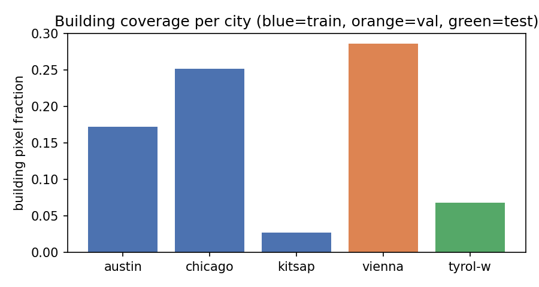
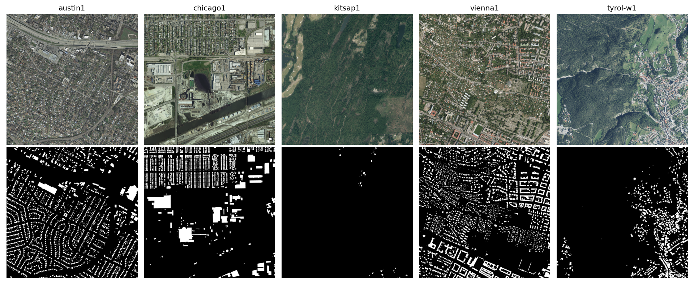
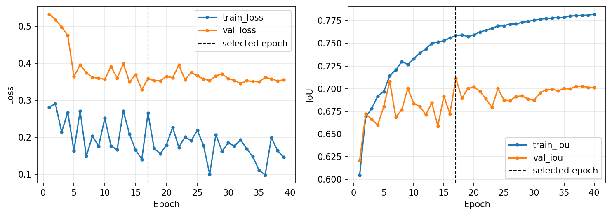
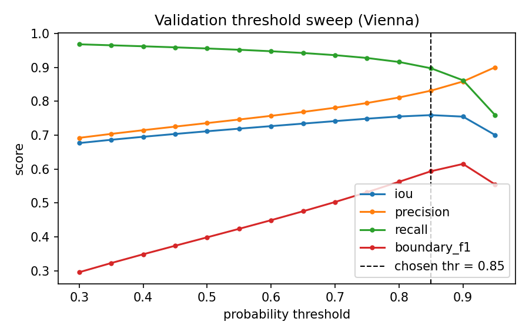
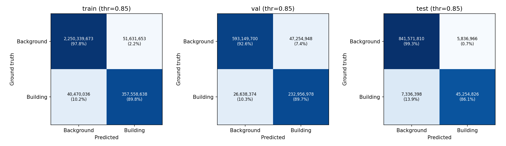
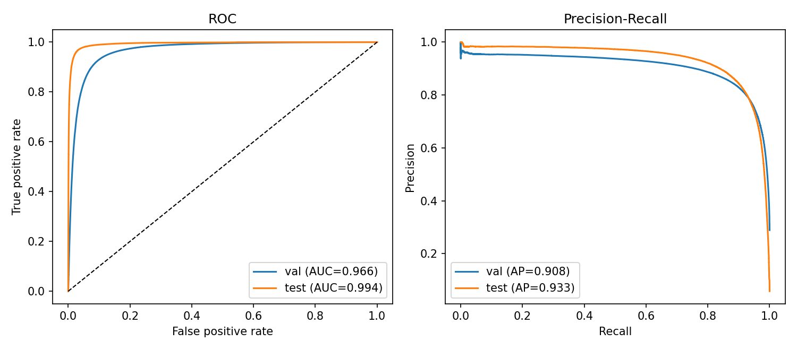
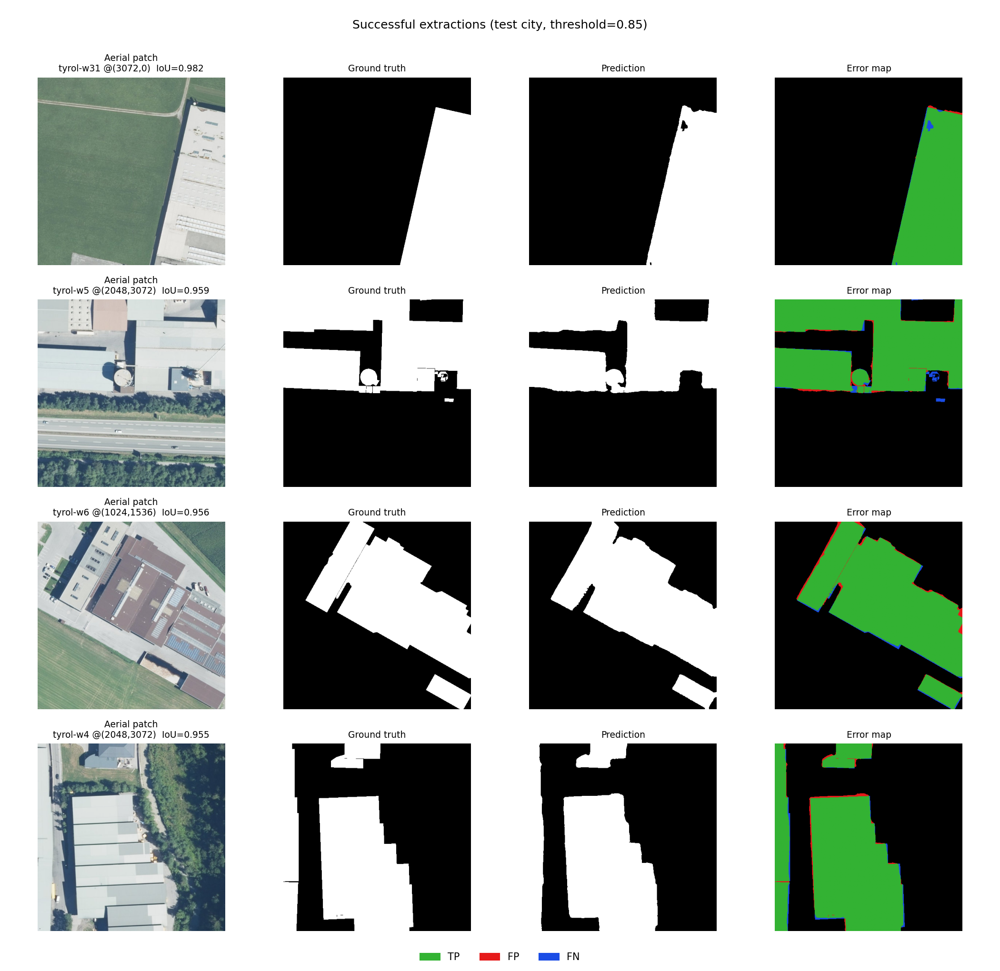
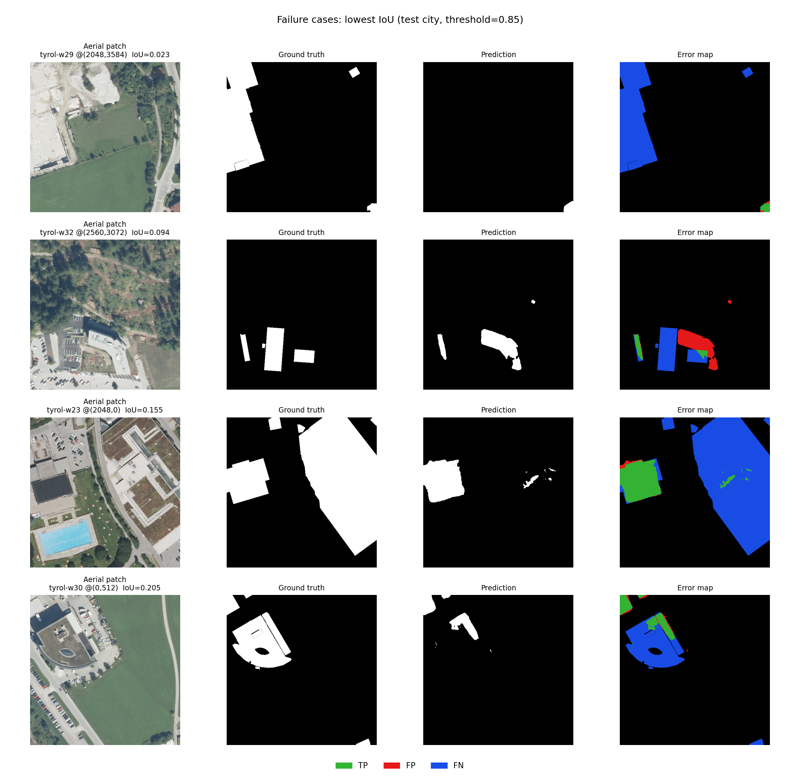
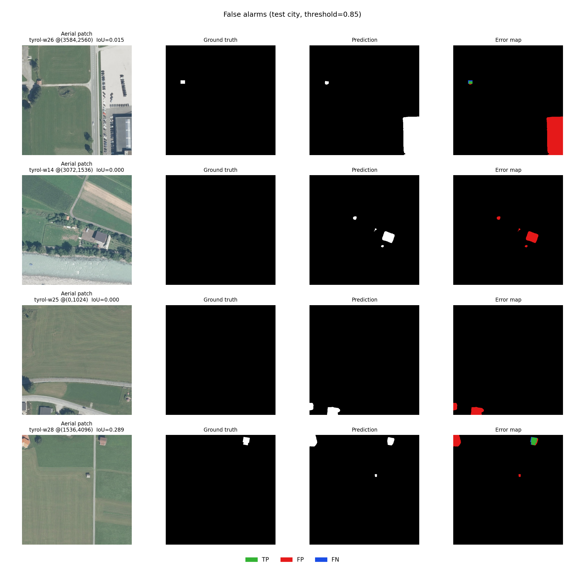

# Building Footprint Segmentation — Inria Aerial Image Labeling

End-to-end binary semantic segmentation of building footprints from 0.3 m aerial imagery, using **SegFormer-B3** with a **city-disjoint train/validation/test split** to prevent spatial data leakage.

**Test city (West Tyrol, held out, final inference — overlapping windows + 4-view TTA):**

| IoU | Dice | Precision | Recall | Boundary IoU | Boundary F1 |
|---|---|---|---|---|---|
| 0.7750 | 0.8732 | 0.9001 | 0.8479 | 0.2976 | 0.7872 |

A runnable walkthrough that reproduces everything below is in [`Building_Segmentation.ipynb`](./Building_Segmentation.ipynb).

> **Images.** This README embeds the figures produced by the pipeline. Image files referenced below are expected under `assets/` (copy them there from `outputs_city_split_segformer/evalution` and `notebook_outputs/` after running the scripts/notebook, see [Figures](#figures-and-image-files) at the bottom for the exact filenames and source).

## Table of contents
- [Problem and approach](#problem-and-approach)
- [Repository structure](#repository-structure)
- [Setup](#setup)
- [Usage](#usage)
- [Data partitioning and leakage prevention](#data-partitioning-and-leakage-prevention)
- [Exploratory data analysis](#exploratory-data-analysis)
- [Model architecture](#model-architecture)
- [Loss function](#loss-function)
- [Training setup](#training-setup)
- [Evaluation metrics](#evaluation-metrics)
- [Quantitative results](#quantitative-results)
- [Qualitative assessment and error analysis](#qualitative-assessment-and-error-analysis)
- [Limitations and future work](#limitations-and-future-work)
- [Figures and image files](#figures-and-image-files)
- [Author](#author)

## Problem and approach

- **Task.** Binary mask (255 = building, 0 = background) from 5000x5000 px, 0.3 m RGB tiles across five cities: Austin, Chicago, Kitsap, Vienna, West Tyrol.
- **Split.** By **city**, not by random patch, because patches from the same tile overlap spatially and would leak between splits.
- **Model.** SegFormer-B3 (MiT-B3 encoder, ImageNet-pretrained, fine-tuned end to end + randomly initialised 1-channel decoder head). 47.2 M parameters.
- **Loss.** `0.5 . weighted-BCE (pos_weight=5.92) + 0.5 . Dice`, for the ~14% building class share. An edge-zone boundary loss was tried as a fine-tune and **did not improve validation**, reported as a negative result rather than silently dropped.
- **Boundary precision (what worked instead).** Whole-tile inference with 50%-overlapping windows, smooth blending, and 4-view test-time augmentation (TTA), raises test Boundary F1 from 0.7758 to 0.7872 with no loss retraining.
- **Metrics.** IoU, Dice, precision, recall, Boundary IoU, Boundary F1, ROC/PR-AUC, reported pooled, per city, and per test tile. Pixel accuracy is reported only for reference (misleading under ~86-95% background).

## Repository structure

```
.
|-- train_base.py                 # data pipeline, city split, patch grid, DiceWeightedBCELoss, training loop
|-- train_segformer.py           # SegFormer-B3 model + training entry point (wraps train_new.py)
|-- test_segformer.py            # leakage audit, metrics, per-city/per-tile results, ROC/PR, qualitative figures
|-- boundary_utils.py            # boundary ops, BoundaryAwareLoss, whole-tile overlap+TTA inference
|-- evaluate_boundary.py         # compares models x inference modes (s512 / s256 / s256+tta4), with per-tile caching
|-- finetune_boundary.py         # boundary-aware fine-tune from a trained checkpoint (resumable)
|-- Building_Segmentation.ipynb   # self-contained notebook: split, EDA, model, training, evaluation, visualization
|-- assets/                      # figures embedded in this README (see Figures section)
`-- README.md
```

## Setup

```bash
pip install torch torchvision transformers opencv-python numpy pandas matplotlib scikit-learn pillow nbformat
```

**Data.** Download the [Inria Aerial Image Labeling Dataset](https://project.inria.fr/aerialimagelabeling/) and arrange it as:
```
AerialImageDataset/
`-- train/
    |-- images/*.tif
    |-- gt/*.tif
-- test/
    |-- images/*.tif

```
The official `test/` folder has no public masks and is not used for quantitative evaluation.

## Usage

```bash
# 1. Train (ImageNet-pretrained SegFormer-B3; resumes automatically if interrupted)
python train_segformer.py

# 2. Evaluate: leakage audit, metrics, per-city/per-tile tables, ROC/PR, qualitative figures
python test_segformer.py --checkpoint outputs_city_split_segformer/best_val_iou.pt

# 3. Compare inference modes (non-overlapping / overlap / overlap+TTA); results cached per tile
python evaluate_boundary.py \
  --models baseline=outputs_city_split_segformer/best_val_iou.pt \
  --configs s512 s256 s256+tta4

# 4. (Optional) boundary-aware fine-tune -- in this run it did not beat the baseline on validation
python finetune_boundary.py --init-checkpoint outputs_city_split_segformer/best_val_iou.pt
```

Or open `Building_Segmentation.ipynb` and *Restart & Run All*, it loads the saved checkpoint by default (no retraining required) and reproduces everything below end to end.

**Pretrained checkpoint.** `best_val_iou.pt` (~180 MB, best validation epoch 17): **[download link](https://1024terabox.com/s/1n29DKRamVEGQ8eu6s7XWuw)**

**Checkpoint for boundary.** `last_checkpoint.pt` (~540 MB, best validation): **[download link](https://1024terabox.com/s/1vz3lbMdjm30ffyyJL_Zy4A)**


## Data partitioning and leakage prevention

Random patch-level splitting is unsafe here: patches cut from the same 5000x5000 tile share neighbouring pixels, and buildings, roofs and street patterns repeat within a tile and within a city. A model would then be tested on near-duplicates of what it trained on. The data is therefore split **by city**, the strictest partition it allows.

| Split | Cities | Tiles | Patches (512x512) | Role |
|---|---|---|---|---|
| Train | Austin, Chicago, Kitsap | 108 | 10,800 | Weight updates only |
| Validation | Vienna | 36 | 3,600 | Checkpoint selection, threshold tuning |
| Test | West Tyrol | 36 | 3,600 | Final evaluation only |

How the design prevents leakage, and how it is verified in code:
- **Split before patching.** Tile IDs are assigned to splits first; patch indices are generated per split afterwards, so no patch can cross a split boundary.
- **Geographic disjointness.** No city appears in more than one split, so there are no neighbouring-tile or same-district overlaps. Test performance measures generalisation to an unseen city.
- **Non-overlapping grid.** Every split uses a non-overlapping 512x512 grid (100 patches per tile, padded from 5000 to 5120 pixels).
- **Automated audit.** `test_segformer.py` / the notebook assert that (i) tile IDs are pairwise disjoint, (ii) city sets are pairwise disjoint, (iii) every patch references only tiles of its own split with no duplicates, and (iv) all patch origins lie on the 512-pixel grid. All checks pass; the full tile list per split is saved to `split_manifest.json`.
- **Role separation.** The test city is never used to choose the checkpoint, the decision threshold, or any hyper-parameter. Both are selected on Vienna only.


## Exploratory data analysis

Building coverage differs strongly by city: from 4.9% of pixels in Kitsap to 28.8% in Vienna, and 14.4% across the training split. This class imbalance, and its variation between cities, shapes the loss and metric choices.

| City | Role | Building fraction |
|---|---|---|
| Austin | Train | 0.150 |
| Chicago | Train | 0.243 |
| Kitsap | Train | 0.049 |
| Vienna | Validation | 0.288 |
| West Tyrol | Test | 0.058 |




## Model architecture

**SegFormer-B3**: a hierarchical Mix Transformer (MiT-B3) encoder with a lightweight all-MLP decoder head, 47.2 M parameters (encoder 44.1 M, decoder head 3.2 M), 1 output channel.

- Hierarchical multi-scale features suit objects from small sheds to large industrial roofs.
- Self-attention gives a large receptive field for context (shadows, road layout, roof continuity) that a plain convolutional backbone sees only locally.
- The all-MLP head is light and avoids the heavy dilated-convolution decoder of DeepLab-style models.
- Logits are bilinearly upsampled to the input resolution before the loss.
- **Transfer learning.** The encoder starts from **ImageNet-pretrained** weights and is fine-tuned end to end; the decoder head is randomly initialised.

## Loss function

```
L = 0.5 . BCE_w + 0.5 . (1 - Dice)
```
- **Class imbalance.** BCE uses a positive-class weight of 5.92, computed as `(1-p)/p` from the sampled training-city foreground fraction `p = 0.144`, capped at 10. Dice is computed per image and is insensitive to the large background area.
- **Boundary precision.** Dice penalises mismatched overlap directly, so edge pixels of small footprints carry more weight than under plain BCE. The final model's loss has no dedicated boundary term: an edge-zone BCE fine-tune (`BoundaryAwareLoss` in `boundary_utils.py`) was tried and **did not improve validation** (see [Boundary-aware fine-tuning](#boundary-aware-fine-tuning-negative-result) below), so edge quality is instead measured with boundary metrics and improved through overlapped, augmented inference.

## Training setup

| Item | Setting |
|---|---|
| Input | 512x512 RGB patches, ImageNet mean/std normalisation |
| Augmentation | Horizontal/vertical flips, random 90-degree rotations, brightness/contrast jitter, light Gaussian blur |
| Optimiser | AdamW, lr 5e-5, weight decay 1e-4; ReduceLROnPlateau on validation IoU (factor 0.5, patience 5) |
| Precision / seed | Mixed precision (AMP) on GPU; seed 99 |
| Checkpoint | Best validation IoU, epoch 17 |
| Encoder init | ImageNet-pretrained `nvidia/mit-b3` |
| Final inference | Whole-tile sliding windows (512 px, stride 256, 50% overlap) with smooth sine-ramp blending and 4-view TTA (identity, horizontal flip, vertical flip, 180-degree rotation); probabilities averaged, threshold chosen on validation |



## Evaluation metrics

All metrics are pooled TP/FP/FN/TN counts over the split, computed on **real tile pixels only** (padding added to reach 5120 px is excluded). Pixel accuracy is reported only for reference: with 71-95% background it is dominated by true negatives.

- **IoU (Jaccard):** primary metric and checkpoint-selection criterion. **Dice/F1**, **precision** (over-segmentation), **recall** (missed buildings).
- **Boundary IoU:** IoU restricted to a 3-pixel band (~0.9 m) along each mask contour , sensitive to edge placement, not interior area.
- **Boundary F1:** precision/recall of predicted vs. true contour pixels, matched within a 3-pixel tolerance.
- **ROC-AUC / PR-AUC** on a random subsample of 2M valid pixels per split; threshold-independent, PR-AUC more informative under imbalance.
- **Inference modes** (`evaluate_boundary.py`): non-overlapping 512-px windows (`s512`, as in training), 50%-overlapping windows with smooth blending (`s256`), and overlap + 4-view TTA (`s256+tta4`), scored on whole tiles so window seams do not affect the metrics. Threshold chosen on Vienna separately per mode.
- **Threshold.** Results shown at 0.5 and at the IoU-maximising threshold found on the validation city only (0.85).

*(TTA = Test-Time Augmentation.)*



## Quantitative results

**Table 1. Metrics at the validation-tuned threshold (0.85), pooled per split (non-overlapping 512-pixel windows).**

| Split / scope | IoU | Dice | Precision | Recall | Pixel acc. | Boundary IoU | Boundary F1 |
|---|---|---|---|---|---|---|---|
| Train (Austin, Chicago, Kitsap) | 0.7952 | 0.8859 | 0.8738 | 0.8983 | 0.9659 | 0.2744 | 0.7361 |
| Validation (Vienna) | 0.7592 | 0.8631 | 0.8314 | 0.8974 | 0.9179 | 0.1869 | 0.5935 |
| **Test (West Tyrol)** | **0.7745** | **0.8729** | **0.8858** | **0.8605** | **0.9854** | **0.2900** | **0.7746** |

**Table 2. Metrics at the default threshold (0.5).**

| Split / scope | IoU | Dice | Precision | Recall | Pixel acc. | Boundary IoU | Boundary F1 |
|---|---|---|---|---|---|---|---|
| Train | 0.7616 | 0.8647 | 0.7903 | 0.9544 | 0.9560 | 0.2001 | 0.6337 |
| Validation (Vienna) | 0.7115 | 0.8314 | 0.7357 | 0.9558 | 0.8882 | 0.0988 | 0.3984 |
| Test (West Tyrol) | 0.7553 | 0.8606 | 0.8037 | 0.9261 | 0.9825 | 0.2208 | 0.6890 |

**Table 3. Per-city results at threshold 0.85.**

| City (role) | IoU | Dice | Precision | Recall | Pixel acc. | Boundary IoU | Boundary F1 |
|---|---|---|---|---|---|---|---|
| Austin (train) | 0.8037 | 0.8912 | 0.8873 | 0.8951 | 0.9671 | 0.3215 | 0.7869 |
| Chicago (train) | 0.8093 | 0.8946 | 0.8759 | 0.9141 | 0.9476 | 0.2563 | 0.7243 |
| Kitsap (train) | 0.7024 | 0.8252 | 0.8211 | 0.8293 | 0.9829 | 0.2100 | 0.6272 |
| Vienna (validation) | 0.7592 | 0.8631 | 0.8314 | 0.8974 | 0.9179 | 0.1869 | 0.5935 |
| **West Tyrol (test)** | **0.7745** | **0.8729** | **0.8858** | **0.8605** | **0.9854** | **0.2900** | **0.7746** |

**Table 4. Threshold-independent measures.**

| Split | Loss | ROC-AUC | PR-AUC |
|---|---|---|---|
| Train | 0.1879 | 0.9908 | 0.9501 |
| Validation | 0.3686 | 0.9666 | 0.9077 |
| Test | 0.1482 | 0.9940 | 0.9336 |




**Table 5. Per-tile results on the 36 test tiles at threshold 0.85 (macro mean +/- std), paired per-tile differences against `s512`.**

| Inference mode | IoU (mean +/- std) | Boundary F1 (mean +/- std) | Delta Boundary F1 vs s512 (tiles improved) | Delta IoU vs s512 (tiles improved) |
|---|---|---|---|---|
| Non-overlapping (s512) | 0.7757 +/- 0.0334 | 0.7804 +/- 0.0350 | — | — |
| Overlap (s256) | 0.7799 +/- 0.0330 | 0.7889 +/- 0.0335 | +0.84 pts (36/36) | +0.42 pts (31/36) |
| Overlap + TTA (s256+tta4) | 0.7767 +/- 0.0329 | 0.7911 +/- 0.0324 | +1.07 pts (35/36) | +0.11 pts (21/36) |

**Table 6. Effect of inference mode on pooled whole-tile metrics; threshold chosen on Vienna per mode (0.85 in all three cases).**

| Mode / split | IoU | Dice | Precision | Recall | Boundary IoU | Boundary F1 |
|---|---|---|---|---|---|---|
| Val: non-overlapping (s512) | 0.7592 | 0.8631 | 0.8314 | 0.8974 | 0.1857 | 0.5935 |
| Val: overlap (s256) | 0.7649 | 0.8668 | 0.8376 | 0.8981 | 0.1900 | 0.6023 |
| Val: overlap + TTA (s256+tta4) | 0.7667 | 0.8679 | 0.8428 | 0.8946 | 0.1932 | 0.6083 |
| Test: non-overlapping (s512) | 0.7745 | 0.8729 | 0.8858 | 0.8605 | 0.2896 | 0.7758 |
| Test: overlap (s256) | 0.7774 | 0.8748 | 0.8927 | 0.8575 | 0.2948 | 0.7839 |
| **Test: overlap + TTA (s256+tta4)** | **0.7750** | **0.8732** | **0.9001** | **0.8479** | **0.2976** | **0.7872** |

**Table 7. Boundary-aware fine-tuning vs. the starting checkpoint on the validation city (Vienna). The test city was not evaluated for the fine-tuned model.**

| Model (validation city) | Threshold | IoU | Boundary IoU | Boundary F1 |
|---|---|---|---|---|
| Starting checkpoint (original loss) | 0.85 | 0.7592 | 0.1869 | 0.5935 |
| Fine-tuned, best epoch (5) | 0.70 | 0.7451 | 0.1799 | 0.5854 |
| Fine-tuned, final epoch (10) | 0.70 | 0.7401 | 0.1714 | 0.5682 |

**Discussion.**
- **Test-city performance.** On the unseen city of West Tyrol the model reaches IoU 0.7745 and Dice 0.8729 (precision 0.886, recall 0.861) at the validation-tuned threshold (non-overlapping windows). Per-tile IoU is 0.776 +/- 0.033, worst tile 0.670, the pooled figure is not driven by a few tiles.
- **Effect of the threshold.** At 0.5 the model over-predicts buildings (test precision 0.804 vs. recall 0.926), consistent with the positive-class weight of 5.92 pushing probabilities upward. Raising the threshold to 0.85 (chosen on Vienna alone) trades 6.6 points of recall for 8.2 points of precision and improves test IoU by 1.9 points; the gain is larger on edge metrics (Boundary F1 0.689 -> 0.775, Boundary IoU 0.221 -> 0.290). That the Vienna-selected threshold also helps on a different, unseen city suggests the calibration shift is systematic.
- **Boundary metrics.** Boundary IoU is low in absolute terms (0.29 on test) because it scores only a narrow band, where a 1-2 pixel offset is heavily penalised. Boundary F1 at 3-pixel tolerance (0.77) is more forgiving. Both are best read comparatively: Vienna has the weakest edges (Boundary F1 0.594 vs. 0.775 on test, 0.787 on Austin).
- **Differences between cities.** Vienna is the hardest split (IoU 0.759); Austin and Chicago are easiest (0.804, 0.809). Kitsap is the weakest training city (0.702). Building coverage alone does not explain this, Kitsap and West Tyrol are both sparse (4.9%, 5.8%) yet differ by 7 IoU points, so building style and layout matter.
- **Why pixel accuracy misleads.** Validation and test differ by only 1.5 IoU points, yet pixel accuracies are 0.918 and 0.985, the gap tracks background share (71% vs. 94%), not model quality.
- **Generalisation.** Train-to-validation IoU gap is 3.6 points (0.795 vs. 0.759); test is within 2 points of training, no severe overfitting to the three training cities.
- **Overlapping windows and TTA.** The best validation configuration is overlap + 4-view TTA (validation IoU 0.759 -> 0.767, Boundary F1 0.594 -> 0.608), so it is the final inference mode. On test, overlap alone raises Boundary F1 from 0.776 to 0.784 and IoU from 0.7745 to 0.7774; adding TTA lifts Boundary F1 to 0.787 and Boundary IoU to 0.298 but leaves IoU at 0.775. The paired comparison (Table 5) shows the overlap gain in Boundary F1 is consistent across all 36 tiles (+0.84 pts, SE 0.08). TTA adds +0.23 Boundary-F1 points (26/36 tiles) but slightly lowers IoU (-0.31 pts, 10/36 tiles improve): precision rises (0.893 -> 0.900) while recall falls (0.858 -> 0.848) at the same threshold, consistent with averaged probabilities being less confident; a finer threshold search than the 0.05 grid might recover some recall. Overall, inference-time gains are real but small: about one Boundary-F1 point, no material IoU change.
- **Boundary-aware fine-tuning (negative result).** To improve edges through the loss, the trained model was fine-tuned for 10 epochs (lr 1e-5) with an extra BCE term restricted to a 3-pixel zone on both sides of every ground-truth contour (weight 0.5). Training loss fell steadily (0.526 -> 0.502), but Vienna scores never reached the starting checkpoint (Table 7): best epoch IoU 0.745, Boundary F1 0.585, vs. 0.759 / 0.594. Checkpoints were selected on validation only, so none was kept and the test city was never evaluated for this model. A plausible explanation is that additional fitting to the three training cities did not transfer to Vienna, though this was not directly tested. The reported model therefore keeps the original loss; boundary gains come from inference (above).

## Qualitative assessment and error analysis

Each figure shows: **aerial patch | ground truth | prediction | error map** (green = true positive, red = false positive, blue = false negative) from the held-out West Tyrol city, threshold 0.85. Patches are selected automatically, not by eye: successes/failures are the highest/lowest patch IoU among fully valid patches with >=5% building coverage (at most one patch per tile); false alarms are the patches with the most predicted-building pixels where ground truth has <0.5% coverage.



**Successes.** The model extracts buildings cleanly when the roof colour is clearly different from the surrounding vegetation, giving strong roof-vs-green contrast. The best cases are buildings with regular, straight-edged outlines, and the predicted boundaries follow these edges closely. Buildings with curved or irregular outlines are not among the cleanest extractions. In these cases the predicted mask closely matches the ground truth, with few false-positive or false-negative pixels in the error map.



**Failures.** The lowest-IoU patches share one pattern: bright, white-toned surfaces that are not rooftops. Pale or white ground, and roads with white markings, are confused with building roofs, and the model predicts building pixels there (red, false positives). A second cause is low contrast: where vegetation is very pale or absent, the difference between roof and surrounding ground is small, so edges become uncertain or parts of a building are missed (blue, false negatives). These failures stem from appearance ambiguity rather than object shape, the model relies strongly on colour contrast and can be fooled when non-building surfaces look like roofs.



**False alarms.** The model predicts buildings where ground truth has almost none, mainly for very small objects and in scenes where fields are not green (bare or dry ground), the ground offers little colour contrast with roofs, and small bright or roof-like patches are mistaken for buildings. A promising future direction is a detection-plus-prompting approach: YOLO to locate small objects, SAM (Segment Anything) to delineate them.

## Limitations and future work

- **Single test city and single seed.** Results describe generalisation to West Tyrol only. Per-tile spread (Table 5) shows variation within the city, but other held-out cities may score differently. Rotating the held-out city and averaging would be stronger.
- **The boundary term did not help.** The edge-weighted fine-tune did not beat the original checkpoint on validation (Table 7). Only one edge weight (0.5), one learning rate and three validation thresholds were tried, so a broader search, or a boundary loss applied from the start of training, is not ruled out. Absolute Boundary IoU remains low (0.30 on test).
- **Two evaluation protocols.** Tables 1-4 score non-overlapping 512x512 windows within each window, so contours cut by a window border are not scored. Table 6 scores whole tiles and is the more faithful measure; the two agree closely for the same inference (test IoU 0.7745 in both).
- **Small inference gains.** Differences between inference modes are a few tenths of a point in IoU. The paired tile analysis supports the Boundary F1 gain but not an IoU gain from TTA, and the 0.05 threshold grid limits how finely the threshold was tuned.
- **Boundary metric details.** Both boundary metrics use a square structuring element with a 3-pixel width/tolerance, so absolute values depend on those settings. ROC/PR use a 2-million-pixel random subsample per split.

## Figures and image files

| File (place under `assets/`) | Produced by | Shows |
|---|---|---|
| `split_manifest.json` | `test_segformer.py` / notebook Sec. 2 | Split sizes and the leakage-audit output |
| `eda_foreground_per_city.png` | notebook Sec. 3 | Building-coverage bar chart per city |
| `eda_examples.png` | notebook Sec. 3 | One example tile + mask per city |
| `learning_curves.png` | `test_segformer.py` / notebook Sec. 6 | Train/val loss and IoU vs. epoch |
| `threshold_sweep_val.png` | `test_segformer.py` / notebook Sec. 7 | IoU/precision/recall vs. threshold on Vienna |
| `confusion_matrices.png` | `test_segformer.py` / notebook Sec. 7 | Pixel-level confusion matrices, train/val/test |
| `roc_pr.png` | `test_segformer.py` / notebook Sec. 7 | ROC and Precision-Recall curves |
| `qualitative_success.png` | `test_segformer.py` / notebook Sec. 8 | Successful extractions (image/GT/pred/error map) |
| `qualitative_failure.png` | `test_segformer.py` / notebook Sec. 8 | Failure cases (lowest IoU) |
| `qualitative_false_alarm.png` | `test_segformer.py` / notebook Sec. 8 | False alarms |
| `whole_tile_example.png` | notebook Sec. 9 | Full-tile prediction, overlap+TTA |

Run `test_segformer.py` (writes to `outputs_city_split_segformer/evaluation/`) and/or the notebook (writes to `notebook_outputs/`), then copy or symlink the files above into `assets/` before pushing, e.g.:
```bash
mkdir -p assets
cp outputs_city_split_segformer/evaluation/*.png notebook_outputs/*.png assets/
```

## Author

Md. Nadim Mahamood, [GitHub](https://github.com/nadimbrur) . [Google Scholar](https://scholar.google.com/citations?hl=en&user=UcRZAJcAAAAJ)
